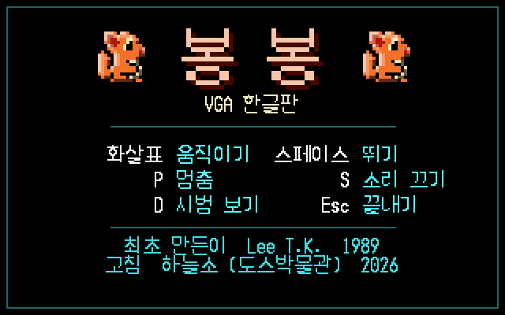
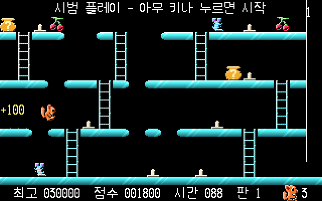
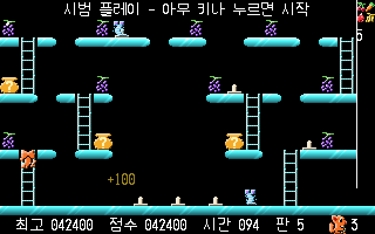
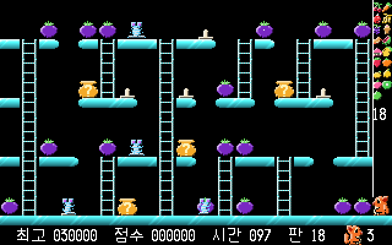
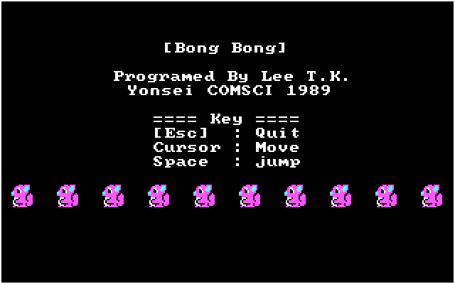
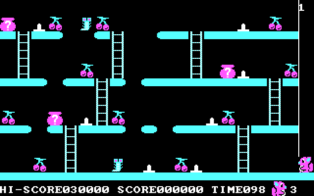

# 봉봉 (BONG BONG) — 1989년 도스 게임 되살리기

**봉봉**은 1989년 연세대학교 전산과의 Lee T.K. 님이 터보 파스칼로 만든 도스 게임입니다.
너구리가 사다리와 발판을 오르내리고 뛰어다니며 먹이를 모으는 게임으로, CGA 4색 화면에서
돌아갔습니다.

이 프로젝트는 원판 `BONGBONG.EXE` 를 역어셈블해서 C 언어로 다시 옮긴 것입니다. 그리고 그 코드를
바탕으로 **움직임은 부드럽게, 그림은 256색으로, 글자는 한글로, 음악은 애드립으로** 새로 꾸민 판도
함께 만들었습니다.

| 프로그램 | 어떤 판인가요 |
| --- | --- |
| `BONGBONG.EXE` | 1989년 원판을 그대로 재현. CGA 4색 그림, 영문, 10판, 본체 스피커 소리 |
| `BONGVGA.EXE` | 새로 꾸민 한글판. 부드러운 움직임, 입체 음영, 20판, 최고 점수표, 애드립 음악 |

두 판 모두 요즘 컴퓨터에서도 원판이 의도한 빠르기로 돕니다.

## 화면

| 첫 화면 (한글판) | 게임 중 (한글판) |
| --- | --- |
|  |  |

| 4판 (한글판) | 새로 만든 18판 (한글판) |
| --- | --- |
|  |  |

| 첫 화면 (1989년 원판) | 게임 중 (1989년 원판) |
| --- | --- |
|  |  |

## 어떤 게임인가요

너구리를 움직여 판에 흩어진 **먹이**를 모두 먹으면 다음 판으로 넘어갑니다.

- 층마다 **오리(적)** 가 좌우로 오갑니다. 닿으면 죽습니다. 피하려면 사다리로 그 층을 벗어나야 합니다.
- 너구리는 한 칸씩 걷거나, 두 칸을 **대각선으로 뛰어** 구멍을 건넙니다.
- 발판에 뚫린 구멍으로 떨어지거나 **압정**을 밟으면 죽습니다.
- **? 항아리**를 먹으면 보너스 점수(500 / 1000)를 받습니다.
- 어떤 칸을 밟으면 **움직이는 발판**이 생깁니다.
- 제한 시간 100초 안에 깨야 합니다. 남은 시간은 보너스 점수가 됩니다.

### 조작

| 키 | 하는 일 |
| --- | --- |
| ← → ↑ ↓ | 걷기, 사다리 오르내리기 |
| Space | 뛰기 |
| P | 잠깐 멈추기 (한글판) |
| S | 소리 켜기/끄기 (한글판) |
| D | 첫 화면에서: 1판부터 끝판까지 컴퓨터가 깨 보이는 시범 (한글판) |
| Alt + ← → | 이전 판 / 다음 판으로 건너뛰기 (한글판) |
| Esc | 끝내기 |

## 해 보는 방법

요즘 컴퓨터(윈도우)에서는 도스 프로그램이 바로 돌지 않으므로 **DOSBox** 라는 무료 도스 흉내 프로그램을 씁니다.

1. [DOSBox](https://www.dosbox.com/) 를 설치합니다.
2. 이 저장소의 `release` 폴더 안에 있는 `BONGVGA` (한글판) 또는 `BONGBONG` (원판) 폴더를 준비합니다.
3. DOSBox 를 켜고 다음처럼 입력합니다. (`C:\games\BONGVGA` 는 폴더를 둔 곳으로 바꾸세요)

   ```
   mount c C:\games\BONGVGA
   c:
   bongvga
   ```

   원판은 마지막 줄에 `bongbong` 이라고 칩니다.

폴더 안 파일은 지우지 말고 함께 두어야 합니다. 특히 `CWSDPMI.EXE` 는 프로그램을 돌리는 데 꼭 필요한
보조 프로그램입니다.

| 파일 | 내용 |
| --- | --- |
| `16X16.DAT` | 그림 42장 (1989년 원본 파일) |
| `16X16B.DAT` | 11~20판에 쓰는 새 먹이 10가지 (한글판) |
| `B_ST.DAT` | 판 자료. 앞의 10판은 원본 그대로, 뒤의 10판은 새로 만든 것 |
| `SOUND.DAT` | 애드립 곡 여덟 개 (한글판) |
| `HSMALL.FNT` `ESMALL.FNT` | 한글·영문 글꼴 (한글판) |
| `BONG.HI` | 최고 점수표. 게임이 스스로 만듭니다 (한글판) |

배경음악은 애드립(OPL2) 소리 카드로 납니다. DOSBox 는 기본으로 이 카드를 흉내 내므로 따로 맞출 것이
없습니다.

## 한글판에서 달라진 점

### 보기

- 원판은 16픽셀 칸 단위로 뚝뚝 끊겨 움직였습니다. 한글판은 너구리·오리·발판이 **한 점씩 미끄러지듯**
  움직이고, 더블 버퍼로 그려 깜빡이지 않습니다. 칸을 지나는 데 걸리는 시간은 원판과 같아서
  게임 빠르기는 그대로입니다.
- 원판 그림에 **입체 음영**을 넣었습니다 (빛이 왼쪽 위에서 온다고 보고 테두리를 밝게·어둡게).
- 발판은 색띠와 **사선 빛줄기**로 두께를 주고, 위층은 밝게 아래층은 묵직하게 칠했습니다.
- 너구리가 걸을 때 발을 놀리고, **꼬리를 흔들고, 눈을 깜빡**입니다. 오리는 몸을 꿈틀거립니다.
- 뛸 때 발밑에 먼지가 일고, 먹이를 먹으면 점수가 떠오르며, 아이템이 가끔 반짝입니다.
- 화면 글자를 모두 **한글**로 바꾸었습니다.

### 놀이

- **판이 20개**입니다. 11~20판은 원판 10판의 규칙을 읽어 새로 짰고, 먹이 그림도 10가지
  (딸기, 오렌지, 레몬, 배, 복숭아, 키위, 라임, 망고스틴, 사포딜라, 파파야)를 새로 그렸습니다.
  11판부터는 한 층에 오리가 두 마리까지 나옵니다. 어디에 서 있든 두 수 안에 사다리로 피할 수
  있도록 판을 짜고 기계로 검사했습니다.
- 20판을 모두 깨면 축하 화면이 나오고 게임이 끝납니다 (원판은 1판으로 돌아가 끝없이 돌았습니다).
- **최고 점수표** 다섯 자리를 `BONG.HI` 에 남깁니다. 이름 세 글자를 자판으로 칩니다.
- 목숨을 다 쓰면 10초 동안 **이어하기**를 물어봅니다. 점수는 그대로 두고 죽은 판부터 다시 합니다.
- 첫 화면에 가만 두면 컴퓨터가 한 판을 **시범**으로 보여 줍니다.

### 소리

애드립으로 여덟 곡을 넣었습니다. 첫 화면 곡은 원판의 비프 가락을 음 하나 바꾸지 않고 애드립으로
옮긴 것이고, 나머지는 새로 지었습니다.

| 나오는 때 | 곡 |
| --- | --- |
| 첫 화면 | 원판 비프 가락을 애드립으로 |
| 게임 중 | 배경음악 |
| 판을 깼을 때 | 팡파르 |
| 떨어질 때 | "삐이익~" 미끄러지는 소리 |
| 게임 끝 | 천천히 내려앉는 단조 가락 |
| 다 깼을 때 | 첫 화면 가락을 웅장하게 |
| 최고 기록 | 느긋하고 뿌듯한 곡 |
| 이어하기 | 째깍대는 박자 위의 조바심 나는 가락 |

## 어떻게 만들었나요

### 원판 그대로 옮기기

원판은 볼랜드 **터보 파스칼**로 만든 16비트 도스 프로그램입니다 (문자열이 길이를 앞에 둔 파스칼
문자열이고, Graph/Crt/System 유닛을 부릅니다). 실행 파일 가운데 게임 코드는 9,609바이트이고 나머지는
런타임입니다. 이 게임 코드를 한 줄씩 읽어 C 로 옮겼고, 함수 33개 모두에 하는 일에 맞는 이름을 붙였습니다.
함수와 변수마다 원래 자리(오프셋)를 주석으로 남겨 두어 원판과 견주어 볼 수 있습니다.

원판 그대로 고친 버그가 하나 있습니다. `16X16.DAT` 의 그림 사이 구분 줄이 파일 뒤쪽에서 모양이 바뀌는
바람에, 원판은 23번째 그림부터 한 줄씩 밀려 읽어 항아리나 떨어지는 너구리 그림이 깨져 있었습니다.

### 터보 파스칼 대신

djgpp 는 32비트 보호 모드라서 원판이 쓰던 16비트 BGI 드라이버(`CGA.BGI`)를 부를 수 없습니다.
그래서 원판이 부르던 터보 파스칼 함수(Graph / Crt / Dos / System)를 `tp.c` 에 같은 이름, 같은 뜻으로
다시 만들었습니다. 화면은 VGA 320×200 에 그리되 원판처럼 CGA 4색만 써서 원판과 똑같이 보입니다.

### 빠르기

원판은 두 가지 까닭으로 빠른 컴퓨터에서 손도 못 댈 만큼 빨라졌습니다.

1. 터보 파스칼의 `Delay` 가 빈 루프를 돌며 기다리는 방식이라 컴퓨터가 빠를수록 짧아집니다.
2. 게임 루프가 아무 제한 없이 최대 속도로 돕니다.

이 판은 타이머 칩으로 시간을 재서 `Delay` 가 언제나 정확한 시간을 기다리게 했고, 게임 루프를 초당
70번으로 묶었습니다. 원판 게임 코드에서 바뀐 곳은 이 한 줄뿐입니다.

## 개발자를 위한 정보

### 빌드

도스용 C 컴파일러 **djgpp** 가 필요합니다.

```
make -f bongbong.mak            # 두 판 모두
make -f bongbong.mak vga        # bongbong.exe (원판)
make -f bongbong.mak hangul     # bongvga.exe  (한글판)
make -f bongbong.mak clean      # 빌드 결과 지우기
```

### 소스 파일

| 파일 | 하는 일 |
| --- | --- |
| `bongbong.c` | 원판을 옮긴 C 소스 |
| `bongbong_smooth.c` | 한글판. 게임 규칙은 같고 그리기·판·소리·시범 등을 더했다 |
| `tp.c` `tp.h` | 터보 파스칼 Graph/Crt/Dos/System 을 대신하는 층, 애드립 VGM 연주 |
| `listing.asm` | 주석을 단 원판 어셈블리 (대조용) |
| `README_DECOMP.txt` | 역어셈블과 고친 내용을 하나하나 적은 작업 기록 |

### 도구

자료 파일은 파이썬 스크립트로 만듭니다 (PIL 필요).

| 명령 | 하는 일 |
| --- | --- |
| `python tools/mkstage.py` | `B_ST.DAT` 의 11~20판을 만든다 |
| `python tools/verify.py` | 모든 먹이에 닿을 수 있는지 검사 |
| `python tools/safety.py` | 오리를 피할 길이 있는지 따로 검사 |
| `python tools/newfruit.py` | 새 먹이 그림 10가지로 `16X16B.DAT` 을 만든다 |
| `python tools/mkvgm_*.py` | 애드립 곡을 하나씩 `BB0n.VGM` 으로 굽는다 |
| `python tools/mksnd.py` | `BB0n.VGM` 들을 `SOUND.DAT` 하나로 묶는다 |
| `python tools/dosshot.py 대본 폴더` | DOSBox 를 창 없이 돌려 대본대로 키를 넣고 화면을 찍는다 |

`dosshot.py` 는 환경변수 `BBTEST` 로 대본 파일을 넘깁니다. 대본이 없으면 게임은 평소처럼 돕니다.

```
2500 shot title      # 2.5초에 TITLE.BMP 로 찍기
3000 key D           # 3초에 D 키
6500 key 0x14D       # 확장키 (0x100 + 스캔코드, 0x14D = →)
33000 quit
```

## 원작

- 봉봉: Lee T.K., 연세대학교 전산과, 1989
- C 이식과 한글판: 하늘소 (도스박물관), 2026
